# New Orkhon / Yeni Orhun

Orkhon script reimagined for a modern era.

[Download fonts](output/New-Orkhon-Fonts-0.16.2.zip?raw=true) · [Presentation PDF](output/New-Orkhon.pdf) · [Editable PowerPoint](output/New-Orkhon.pptx?raw=true) · [Blueprints](output/New-Orkhon-Blueprints.pdf) · [Outlines](output/New-Orkhon-Outlines.pdf)

An experimental typeface in Serif and Sans. Each family covers **42 Orkhon signs**, with an authored capital and lowercase form for each sign. Both use Old Turkic Unicode and right-to-left shaping.

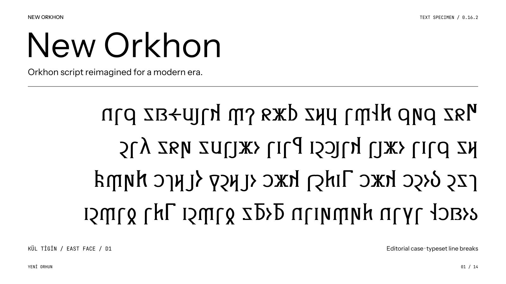

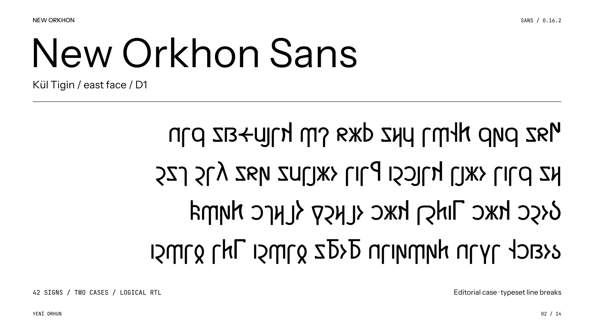

## Serif and Sans

The two families share an alphabet, case system and OpenType features. Serif has contrasting strokes and bracketed terminals; Sans uses more even stroke weights and plain terminals.

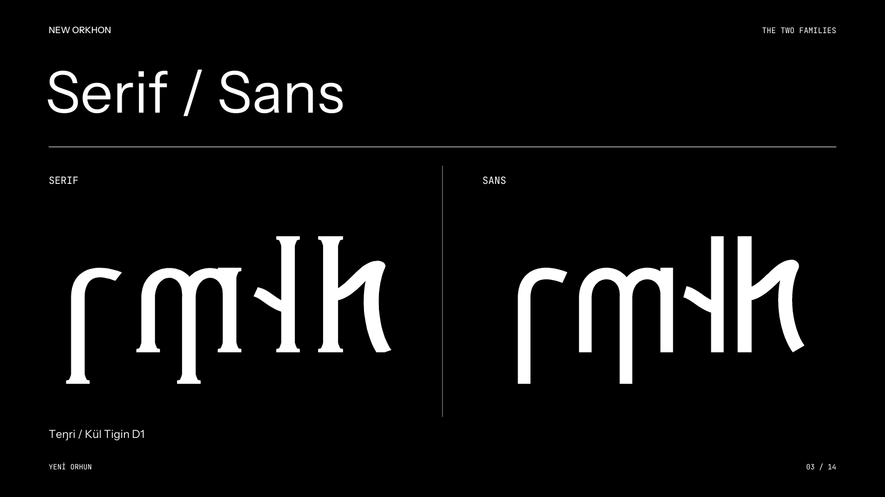

## Original, lowercase, uppercase

Ten words from the Kül Tigin inscription, with Latin readings and Turkish meanings. All three columns use the same Unicode spelling.

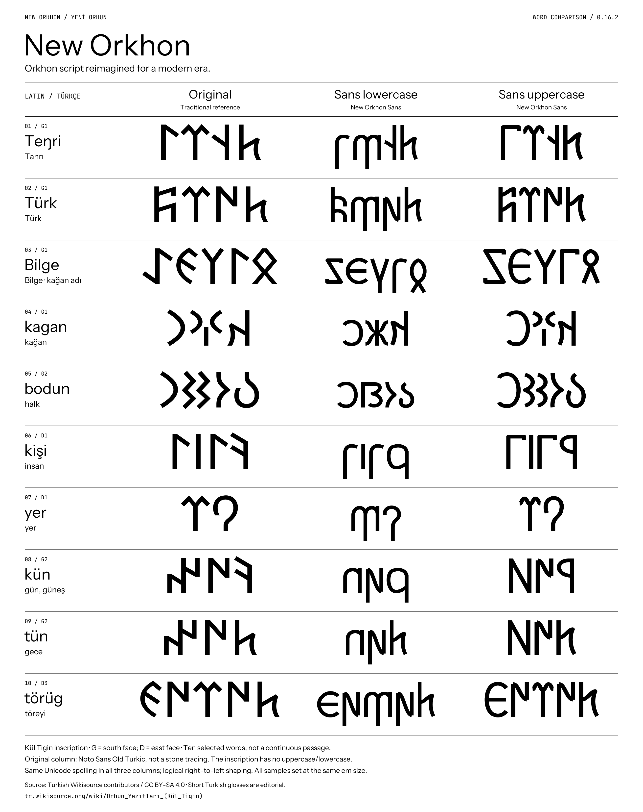

[Vector SVG](word-comparison/New-Orkhon-Sans-Case-Comparison.svg) · [Print PDF](word-comparison/New-Orkhon-Sans-Case-Comparison.pdf)

The reference column uses **Noto Sans Old Turkic**, not tracings of the stone. The inscription has no uppercase/lowercase distinction: New Orkhon's case system is an editorial invention.

## Letterforms

The redesign changes construction, not just angularity. The plates compare reference forms with the new outlines and show the relationship between cases.

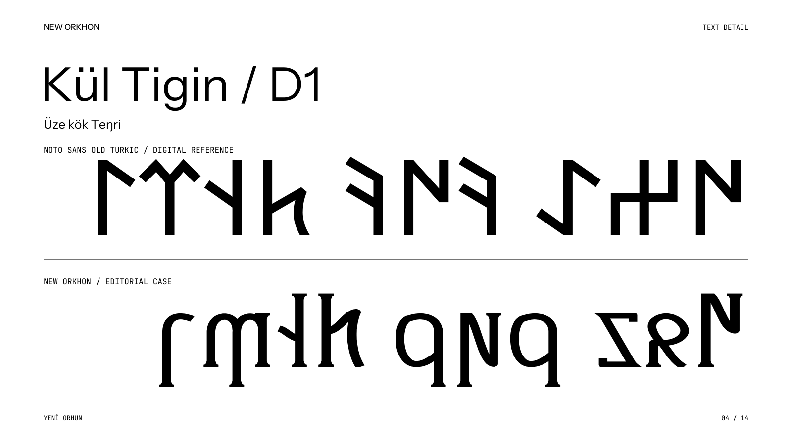

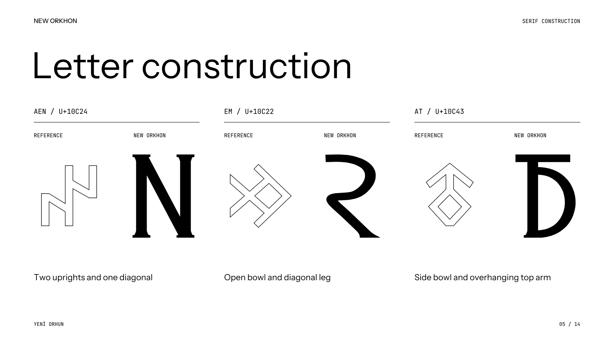

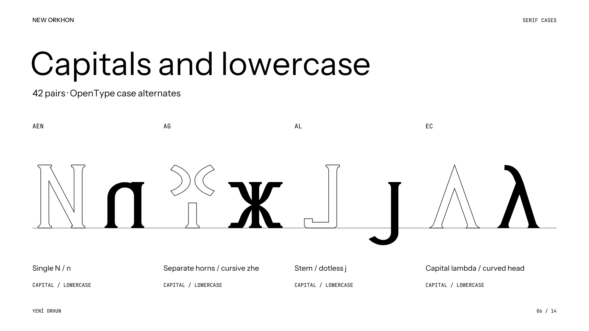

## Construction

The fonts use **1,000 units per em**, a 700-unit cap height, a 510-unit lowercase body and descending forms. Stroke weights, spacing and joins are built into the font source.

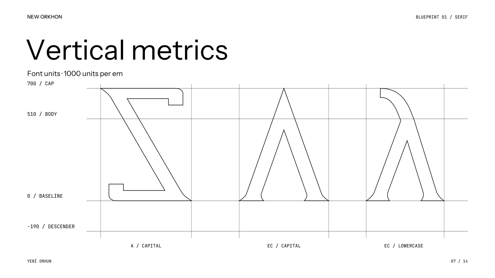

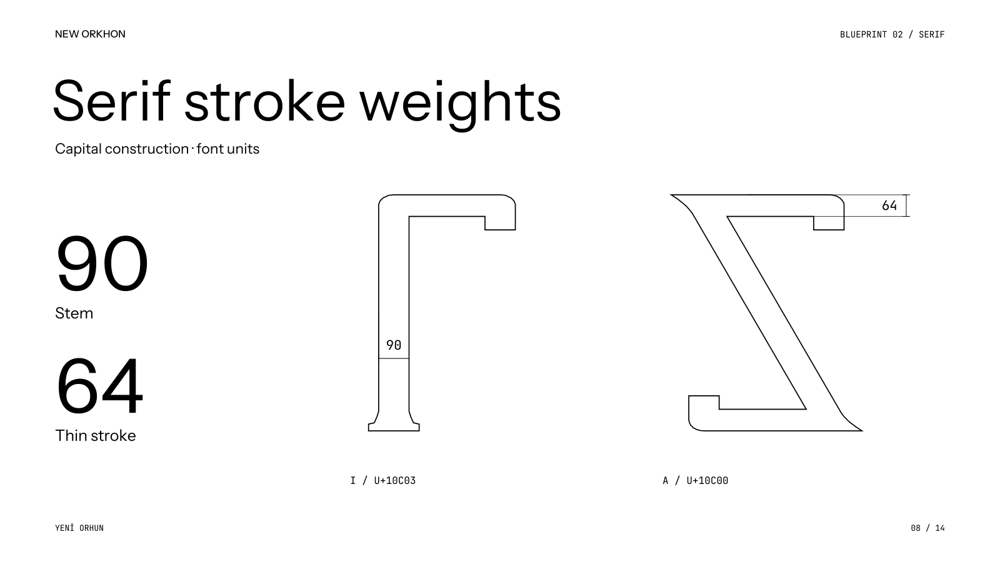

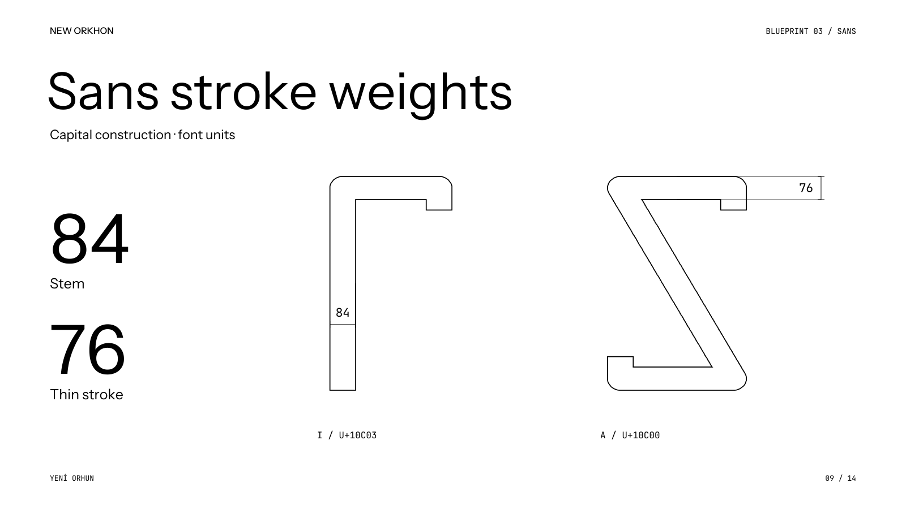

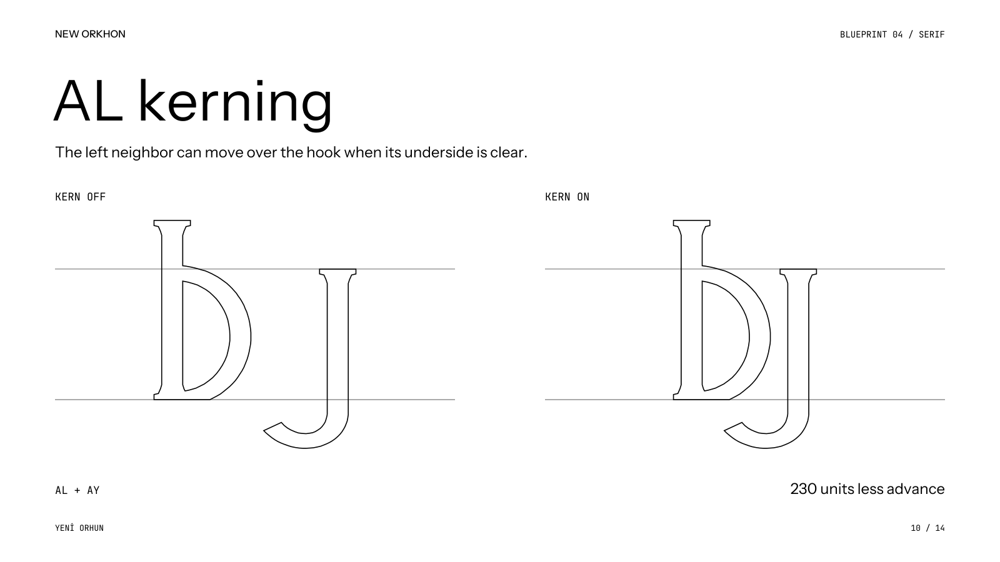

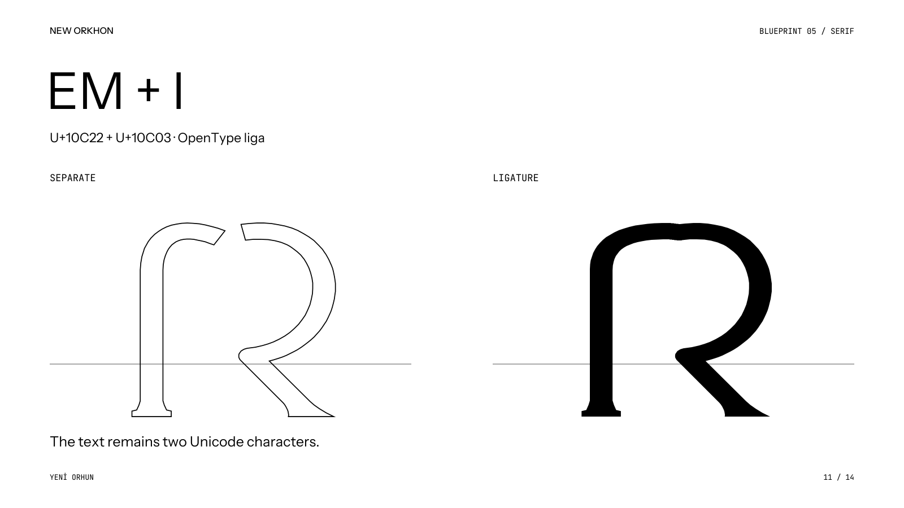

[Five blueprint plates](output/New-Orkhon-Blueprints.pdf) · [Complete outline catalogue](output/New-Orkhon-Outlines.pdf) · [Individual Serif SVGs](output/glyph-outlines/serif) · [Individual Sans SVGs](output/glyph-outlines/sans)

## Alphabet

All 42 signs, shown here as Serif capital/lowercase pairs. The downloadable outline catalogue includes both families: **168 standalone forms** in total.

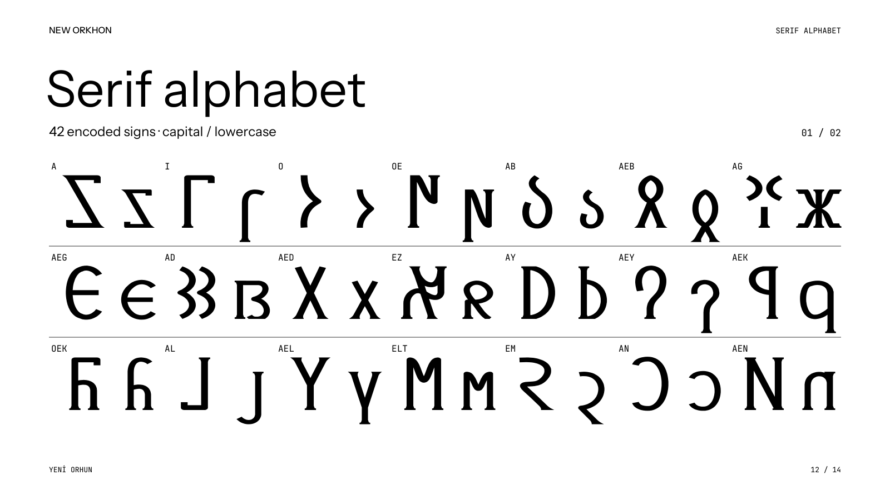

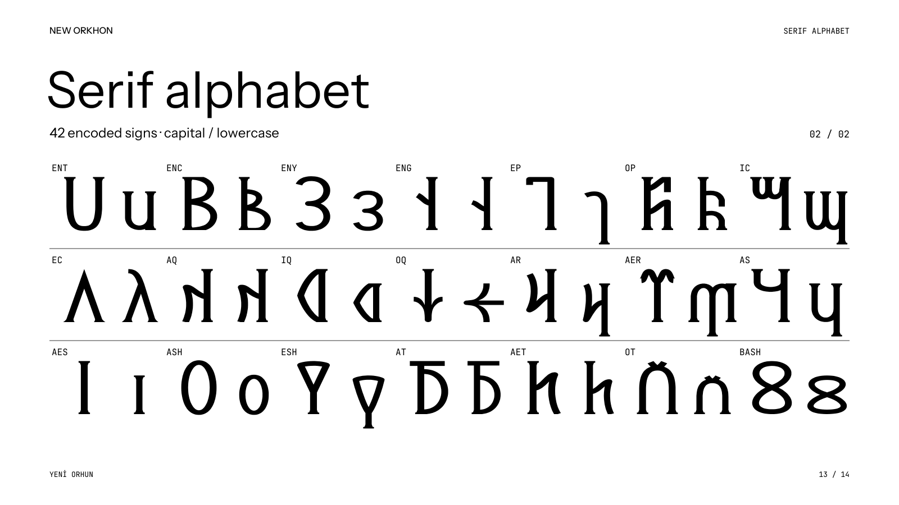

## Install

Download the [font bundle](output/New-Orkhon-Fonts-0.16.2.zip?raw=true), extract it and open the TTF files in your system's font installer. You can also download each font directly:

| Family | Capitals by default | Lowercase by default |
| --- | --- | --- |
| Serif | [New Orkhon Text](typeface/NewOrkhonText-Regular.ttf?raw=true) | [New Orkhon Text Lowercase](typeface/NewOrkhonTextLowercase-Regular.ttf?raw=true) |
| Sans | [New Orkhon Sans](typeface/NewOrkhonSans-Regular.ttf?raw=true) | [New Orkhon Sans Lowercase](typeface/NewOrkhonSansLowercase-Regular.ttf?raw=true) |

The lowercase-default fonts work in apps without OpenType feature controls.

| Feature | Behavior |
| --- | --- |
| `ss01` | Select lowercase in a capital-default font. |
| `ss02` | Select capitals in a lowercase-default font. |
| `kern` | Enable shape-aware spacing around AL. |
| `liga` | Join matching-case EM + I while retaining two Unicode characters. |

Use **logical RTL text**; never reverse the character sequence manually. These are Old Turkic fonts, not Latin keyboard remappings. Case alternates reuse the existing Unicode characters.

For a working text specimen, [download the offline showcase](typeface/New-Orkhon-Showcase.html?raw=true) and open it locally. Its fonts are embedded; controls switch family, case, size and spacing.

## Source

The font outlines are generated from Python path definitions. The presentation uses the actual shaped outlines, and the PowerPoint contains editable vector letterforms rather than screenshots.

```sh
python3 -m venv .venv
. .venv/bin/activate
python3 -m pip install -r requirements.txt
python3 typeface/build.py
python3 typeface/validate.py
python3 typeface/validate_sans.py
python3 deck.py
python3 audit_deck.py
python3 compare_words.py
```

See the [build guide](BUILDING.md) for prerequisites and additional checks, and the [design notes](typeface/DESIGN.md) for construction decisions and historical references. The four TTFs rebuild byte-for-byte.

## Sources and licenses

This is **speculative type design**, not a reconstruction of an attested historical writing style. The inscription spellings, modern readings, Turkish translations and authored letterforms are separate layers. Geometric and shaping checks do not establish reader performance.

- **New Orkhon and Noto Sans Old Turkic:** [SIL Open Font License 1.1](OFL.txt). The Noto reference font is included unmodified.
- **Inscription transcription and Turkish translation:** Turkish Wikisource contributors, [*Orhun Yazıtları (Kül Tigin)*](https://tr.wikisource.org/wiki/Orhun_Yaz%C4%B1tlar%C4%B1_(K%C3%BCl_Tigin)), [CC BY-SA 4.0](https://creativecommons.org/licenses/by-sa/4.0/). Adaptations include normalized spaces, the documented EZ substitution, editorial case and typeset line breaks. Adapted text presentations retain that license.
- **Presentation labels:** [Instrument Sans, SIL OFL 1.1](assets/InstrumentSans-OFL.txt), and [JetBrains Mono, Apache 2.0](assets/JetBrainsMono-Apache-2.0.txt) ([copyright](assets/JetBrainsMono-Copyright.txt)).

Helvetica informed the Sans family's optical balance; no Helvetica files or outlines are included.

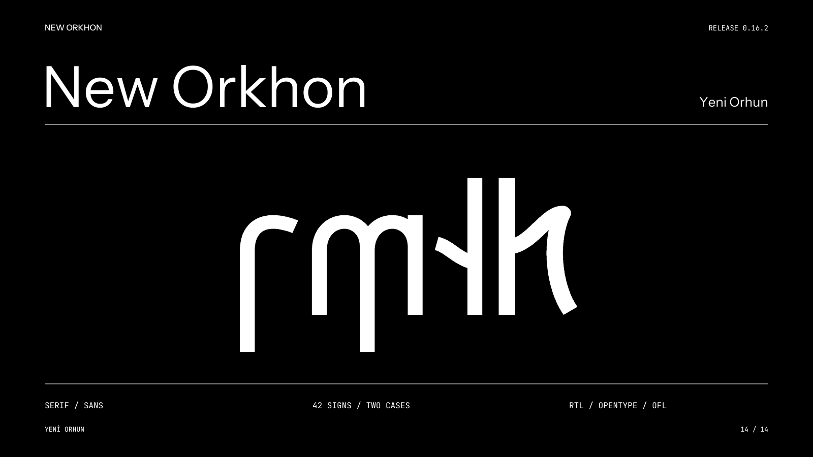
